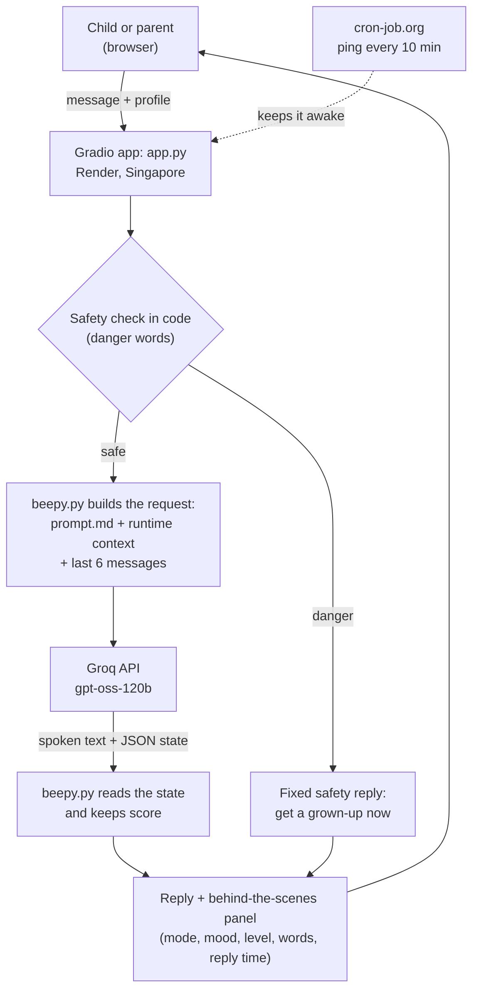

# Beepy: System Design

## 1. Goal

Beepy is a chatbot that teaches English to children under 7. Young children learn best when they feel safe and are having fun, so Beepy is a playmate rather than a strict teacher. The brief asked for five things: a progressive learning system with three levels, detection of the child's mode and mood, social and emotional learning, context-aware responses, and replies in under 2 seconds.

## 2. Architecture

**Components**
- `app.py`: the screen (chat, profile boxes, behind-the-scenes panel) and reply timing.
- `beepy.py`: the safety check, building each AI request, reading the AI's state note, and keeping score.
- `prompt.md`: Beepy's runtime behaviour: safety, levels, modes, SEL and output format (about 1,200 tokens).
- `docs/pedagogy.md`: the full teaching specification the runtime prompt is condensed from.

**One turn, step by step**
1. The safety check runs in code. If danger words appear, Beepy gives a fixed reply and skips the AI.
2. The code builds the runtime context from what it knows: profile, level, streaks, mastered and struggling words, mood and turn number.
3. It sends the prompt (always identical, so Groq caches it), the last 6 messages, and the runtime context with the child's message.
4. The model returns spoken text, then `|||STATE|||`, then a JSON note.
5. The code updates mode, mood, streaks and word lists, and applies level changes with guardrails.
6. The screen shows the reply and the panel.

## 3. Key decisions and trade-offs

**AI-first understanding; the code keeps score.**
My first versions used rules: lessons as data, keyword matching for answers and modes, and the AI only adding one warm sentence. Real children's answers broke the rules ("crying" for a sad face, "doggy", "no" during a game). Now the model understands the child and writes the reply, and the code does what code does better: counting, remembering and enforcing limits.
*Trade-off:* the model can misjudge an answer or a mood. The code verifies level-ups, and the panel makes every judgment visible.

**Spoken text and JSON state in one reply.**
One call per message keeps latency low, and because the spoken part comes first, it can be streamed to text-to-speech later.
*Trade-off:* if the model breaks the format, the child still sees the text, but the turn isn't scored or remembered, so one broken reply can't teach the model a broken format.

**Trust but verify on levels.**
A step down happens whenever the model suggests it, because comfort comes first. A step up needs both the model's suggestion and the code's own count of 3 right answers in a row.

**Safety in two layers.**
A code check catches danger words before the AI and replies with fixed, serious instructions. The prompt puts safety above every other rule, for subtler cases. I added both after red-teaming the app (see the README's Safety testing section).
*Trade-off:* some false alarms, like a butter knife. That's acceptable for children.

**Model: gpt-oss-120b on Groq, with low reasoning effort.**
In my timing test, the 120B model was as fast as the 20B model for short replies (0.39–0.61 s against 0.49–0.61 s), and it followed instructions far better: it mostly stopped the extra-questions bug even before I fixed the design. Low reasoning effort keeps its hidden thinking short.
*Trade-off:* on Groq's free tier, both models have the same small rate limits.

**Prompt size against rate limits.**
My full teaching prompt is about 7,000 tokens. On Groq's free tier (8,000 tokens per minute), only about one message a minute got through. I kept the full version as `docs/pedagogy.md` and condensed the runtime prompt to about 1,200 tokens with the same core rules. The prompt always comes first and never changes, so Groq caches it, and cached tokens don't count toward the rate limit.
*Trade-off:* the condensed prompt has one example instead of five, so the model gets less guidance on unusual cases.

**Hosting.**
Render's free tier, in the Singapore region, the closest to Dhaka. Free services sleep after 15 minutes without visits and take about a minute to wake, which would break the 2-second rule, so cron-job.org pings the app every 10 minutes. A paid plan wouldn't need the ping. Hugging Face Spaces was my first choice, but it now requires a paid plan for Gradio apps.

**State in memory.**
Each browser session has its own state, so two children never share progress. It's simple and private, but progress resets when the page reloads.

## 4. Requirements and how they are met

| Requirement | How it's met | Where |
|---|---|---|
| Progressive learning (L1–L3) | Level definitions and step rules in the prompt; the code keeps the level and streaks and verifies step-ups | `prompt.md` (LEVELS), `beepy.py` (`update`) |
| Child mode detection | The model picks one of four modes every turn, in a fixed priority: support, engagement, conversation, learning. At most 3 learning turns in a row. | `prompt.md` (MODES), side panel |
| Social and emotional learning | Feelings check-in, naming feelings, calming ideas, praise for effort, choices, kindness. The model also tags which SEL skill each turn practises. | `prompt.md` (SOCIAL-EMOTIONAL LEARNING), `sel_competency` in the state |
| Context-aware responses | A runtime context (profile, level, streaks, words, mood, turn number) plus the last 6 messages | `beepy.py` (`runtime_context`, `talk`) |
| Replies under 2 seconds | One call per message, a cached prompt, low reasoning effort, short replies, the Singapore region, no cold starts | Section 5 |

## 5. Latency

- **Measured on the live app:** [N] AI replies, average [x.xx] s, slowest [x.xx] s.
- **What keeps it fast:** one AI call per message, Groq's fast inference, a short prompt that Groq caches, low reasoning effort, replies capped at 35 words, the Singapore region, and a 10-minute ping so the server never cold-starts.
- **Risk:** the API timeout is 5 seconds, so if Groq is slow, a reply can take longer than 2 seconds. Streaming plus a shorter timeout with a fallback reply would fix this.

## 6. Safety and privacy

- The app asks only for a first name, age, likes and topics to avoid. They stay in memory for the session and are never saved to a database.
- Messages go to Groq to generate replies. The server logs record only reply time, mode, mood and level, never what the child typed.
- Beepy never asks for an address, school, phone number or location.
- The two safety layers are described in section 3 and tested in the README.

## 7. Testing

I tested by hand, locally and on the live app, with things a real child might type:
- A normal lesson: greeting and check-in, questions, answers and level-ups.
- Typos and close answers: "doge", "catto", "bluee", "yello", "doggy".
- Feelings: "I'm sleepy", "I'm sad", and "crying" as an answer on a feelings lesson.
- Boredom and play: "this is boring", "no", "let's play".
- Sharing: "my cat is black".
- Rate limits: the 7,000-token prompt on the free tier.
- A safety red-team: the knife scenario, before and after the fix.

Every failure led to a design change (see "How it evolved" in the README).

## 8. Limitations and future work

- **Speech:** many under-7s can't read yet. Add speech-to-text and text-to-speech, streaming the spoken text that comes before the JSON.
- **Saved progress:** a database such as PostgreSQL for profiles, levels and words, plus a simple view for parents.
- **Reliability:** automated tests that replay scripted conversations and check the mode, level and safety outcome.
- **Cost and latency:** fine-tune a small model on good conversations, so the long prompt isn't needed.
- **Bangla support** for parents, and for explaining new words.